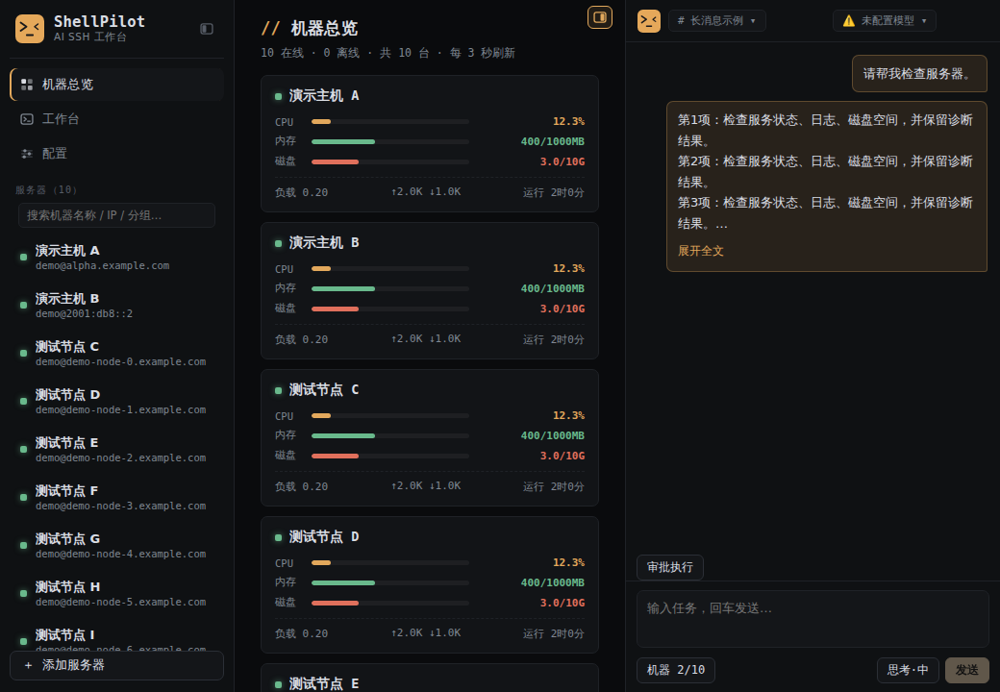
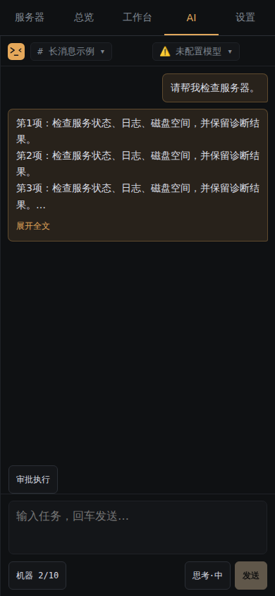
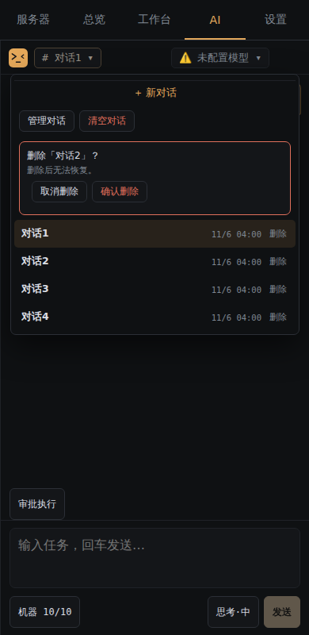

  

<h1 align="center">ShellPilot</h1>

让 AI 与终端一起工作：SSH 终端、服务器监控、文件管理与 MCP。

  
  
  
  

  <a href="https://github.com/HANLINGVABCN/shellpilot/releases/latest">下载最新版</a> ·
  <a href="使用说明.md">使用说明</a> ·
  <a href="docs/MCP.md">MCP 接入</a> ·
  <a href="https://github.com/HANLINGVABCN/shellpilot/issues/new/choose">问题反馈</a>

ShellPilot 是运行在自己电脑或安卓设备上的 SSH 工作台。你可以直接操作终端，也可以让内置 AI 或支持 MCP 的外部 AI 查询服务器、分析日志、执行命令和修改配置。应用使用 Rust 后端与 Tauri 2，安装版不需要额外安装 Node.js。

## 下载与安装

从 [Releases 最新版](https://github.com/HANLINGVABCN/shellpilot/releases/latest) 下载。打开 **Assets** 后，按用途选择：

| 文件 | 用途 |
| --- | --- |
| [ShellPilot-Windows-Setup.exe](https://github.com/HANLINGVABCN/shellpilot/releases/latest/download/ShellPilot-Windows-Setup.exe) | **Windows 首次使用推荐**，双击安装 |
| [shellpilot-app.exe](https://github.com/HANLINGVABCN/shellpilot/releases/latest/download/shellpilot-app.exe) | Windows 主程序；更新已有便携目录时，先退出应用再替换同名文件 |
| [ShellPilot-arm64.apk](https://github.com/HANLINGVABCN/shellpilot/releases/latest/download/ShellPilot-arm64.apk) | Android ARM64 安装包 |
| [SHA256SUMS.txt](https://github.com/HANLINGVABCN/shellpilot/releases/latest/download/SHA256SUMS.txt) | 下载文件的 SHA256 校验值 |

`Source code.zip` 和 `Source code.tar.gz` 是源码，日常使用无需下载。Windows 界面依赖系统 WebView2，安装程序会处理运行时安装。

**安卓升级前先导出配置。** 当前 APK 使用构建时生成的测试签名，不同版本可能无法直接覆盖安装。遇到签名冲突时，先导出配置，再卸载旧版、安装新版并导入。

## 能做什么

- **SSH 终端**：多机器、多标签、固定标签、拖拽排序、终端搜索；机器标签宽度固定，便于连续关闭。
- **实时监控**：CPU、内存、磁盘、网络和运行时间。Linux 使用 `/proc`，Windows 使用 PowerShell/CIM，不需要在服务器安装 ShellPilot Agent。
- **文件管理**：浏览、上传、下载、编辑、复制、移动、回收站、压缩和解压；支持将文件所在目录打开到终端。
- **内置 AI**：流式回答、批量查询、系统诊断、服务日志、文件修改预览、备份和校验；支持停止任务、长消息折叠和历史对话管理。
- **MCP 联动**：内置 AI 与外部 MCP 共用 9 个工具、SSH 连接池、主机授权、执行策略和审计。
- **桌面与手机**：Windows 记忆窗口尺寸、位置和最大化状态；安卓使用适合窄屏的页面导航。

### 界面预览

截图来自实际应用页面，仅使用虚构主机名称和标准示例地址。

  
  

## 三步开始

1. **添加服务器**：填写地址、SSH 端口和用户名，选择密码或私钥登录。首次连接自动保存指纹；之后指纹变化才暂停连接，并在对应机器内容区显示处理入口。
2. **添加 AI 模型**：在「配置」页添加服务商，填写 Base URL 和 API Key，测试并拉取模型，设置默认模型。不配置 AI 也能使用终端和文件管理。
3. **选择机器并发送任务**：在对话框「机器」菜单中勾选目标主机，例如「对比这几台机器的磁盘占用」「检查 nginx 启动失败的原因」。

内置 AI 当前使用 OpenAI 兼容的 `/chat/completions` 接口。需要模型支持工具调用；只填写服务商名称不会自动支持它的原生 API。详见 [AI 配置与参数](使用说明.md#ai-配置与参数)。

## AI 与 MCP

MCP 默认关闭。开启后，在设置里选择允许外部 AI 操作的服务器，并复制自动生成的启动配置。支持 MCP STDIO 的客户端可以启动 `shellpilot-app.exe --mcp`。具体接入及示例见 [MCP 文档](docs/MCP.md)。

| 工具 | 用途 |
| --- | --- |
| `vps_list` | 列出授权主机，不返回凭据 |
| `vps_exec` | 执行命令，返回退出码、标准输出、错误输出和耗时 |
| `vps_exec_batch` | 并行执行独立只读命令 |
| `vps_metrics` / `vps_metrics_batch` | 查询单台或多台服务器指标 |
| `vps_diagnose` | 一次收集系统、CPU、内存、磁盘、网络或服务诊断证据 |
| `vps_logs` | 按服务、时间和行数查询日志 |
| `vps_read_file` | 分页读取文本文件 |
| `vps_write_file` | 预览内容、检查旧哈希、备份、原子替换并校验 |

优先使用批量指标与诊断工具，减少逐条命令往返。[完整能力与限制](AI-MCP改进说明.md)

### 执行模式

| 模式 | 行为 |
| --- | --- |
| 只读查询（MCP） | 拒绝非只读白名单命令及文件写入 |
| 人工审批 | 只读命令自动执行，其他操作在应用界面审批，高风险策略仍拦截 |
| AI 审批 | 配置的审批模型判断，无法判定时转人工 |
| 自动执行 | 自动执行，仍保留高风险拦截 |
| 完全托管 | 授权主机上的命令直接执行，包括修改和删除，不请求审批或执行高风险拦截 |

最大输出 tokens、历史轮数、工具轮数、上下文字符预算默认都是 **0＝应用不设上限**。填写正数可启用限制；模型服务商自身的窗口、输出上限和费用仍然适用。Temperature 默认 0.3，控制随机性。

## 数据与平台说明

桌面应用数据保存在 `%APPDATA%\im.hanling.shellpilot`；配置文件含 SSH 凭据和 AI API Key，不要上传到 Issue 或公开仓库。导出备份使用密码加密，本地 JSON 存储本身不等同于加密保险箱。

凭据不会主动放入 AI 系统提示或主机列表，但你发送的消息及服务器工具输出会传给所选模型服务商。让 AI 读取包含秘密的文件时，输出也可能包含秘密。备份和诊断分享方法见 [数据与隐私说明](docs/SECURITY.md)。

当前发布 Windows x64 与 Android ARM64 包。Linux 可运行 Rust 后端；尚未提供 Linux/macOS 桌面安装包。文件管理和 `vps_diagnose`、`vps_logs` 等结构化运维工具主要面向 Linux，Windows 当前支持 SSH 终端与原生性能指标。

## 开发与反馈

- [贡献和源码运行](CONTRIBUTING.md)：仓库结构、前端开发、后端测试和 GitHub 构建流程。
- [常见问题](使用说明.md#常见问题)：连接、指纹、模型、数据和升级。
- [更新记录](CHANGELOG.md)：版本和已发布的功能。
- [提交 Bug](https://github.com/HANLINGVABCN/shellpilot/issues/new?template=bug_report.yml) / [建议功能](https://github.com/HANLINGVABCN/shellpilot/issues/new?template=feature_request.yml)。

本仓库目前尚未声明开源许可证；公开源码不等同于授予任意分发或商业使用许可。
